# El juego

Un matamarcianos de scroll horizontal: la nave Metalion contra el Dr. Venom,
planeta a planeta. Todo lo de esta página está leído en el código y las
imágenes están dibujadas desde la ROM.

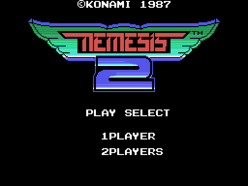

El título lo monta `p01:615B` y sus textos `p01:61C1`. En un MSX japonés (el
byte 0x002B de la BIOS) el logotipo dice GRADIUS, y los textos de la historia
y del final salen en japonés.

## Las fases

El mapa tiene doce fases (`0xE201`). La partida empieza en la 1 con 3 vidas
(`p00:5AD8`). La que sigue la decide `p01:7C59`: se sube de la 1 a la 7, y
después se baja de la 6 a la 0 con `0xE20A` impar, que en muchos sitios trae
más enemigos y más disparos. La 0 es la fortaleza del final, la 8 el
interior de cada jefe y la 9, la 10 y la 11 son secretas. Cada fase tiene un
punto de control (`p01:694A`) desde el que se sigue al perder una vida.

Los mapas se montan desde sus metabloques (`p13:7900`, `p00:4889`):

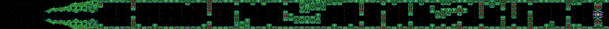
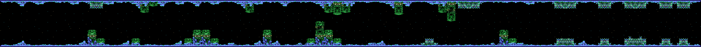
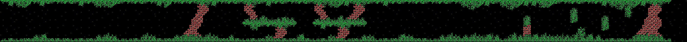
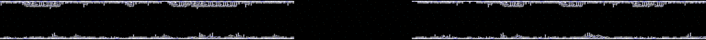
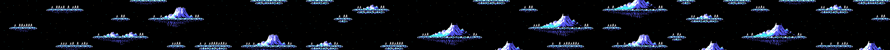
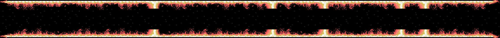
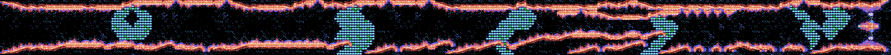
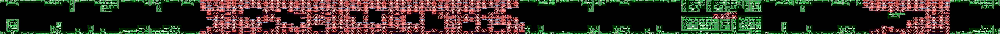
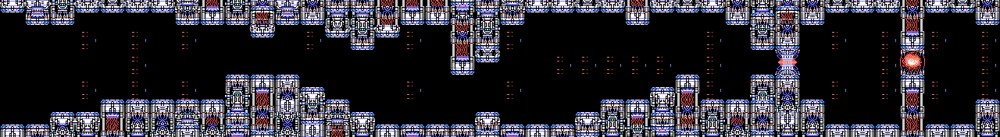
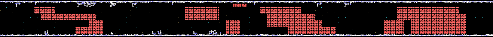
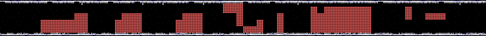
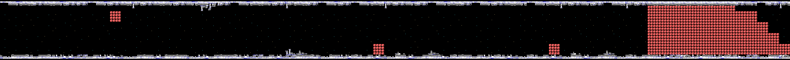

Lo que cierra cada fase lo dice su guion (`p01:7A34`):

| Fase | Al acabar el scroll |
|---|---|
| 1 | el jefe 1 |
| 2 y 3 | el jefe 4 |
| 4 | 600 cuadros más, el jefe 5 y luego el 2 |
| 5 | un pasillo de compuertas de 600 cuadros y luego el jefe 2 |
| 6 | dos piezas que lanzan rocas, sin jefe |
| 7 | el jefe 3 |
| 0 | un núcleo de 100 golpes |

## Los enemigos

Hay 65 tipos de enemigo, cada uno con su ficha de 7 bytes (`p00:4F4C`). En
cada fase salen los de su lista, sus generadores, su oleada y los que
sueltan los objetos y los jefes. Aquí van con el dibujo de su ficha y los
dibujos de sprite de la fase; el número es el tipo.

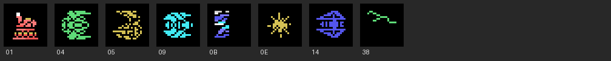
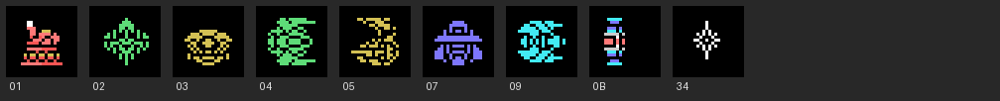
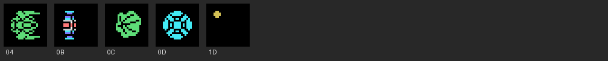
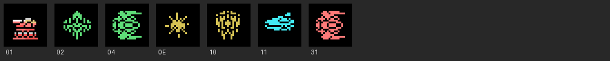
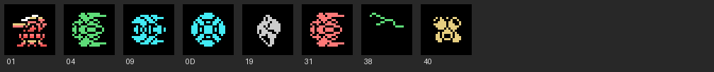
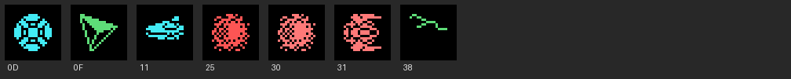
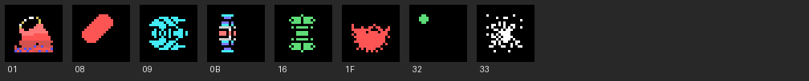
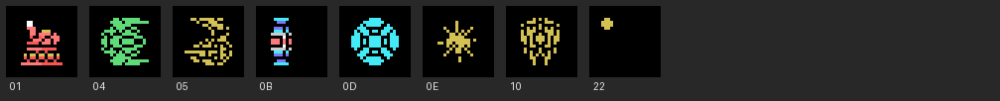
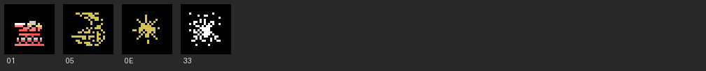

Los objetos de caracteres son parte del mapa: compuertas, cabezas que giran,
torres que sueltan enemigos. Cada clase tiene sus formas (`p15:B661`):

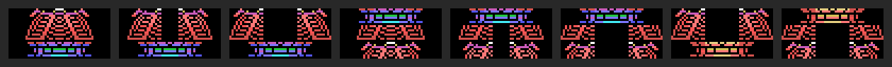
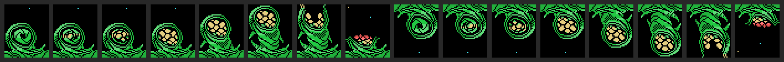
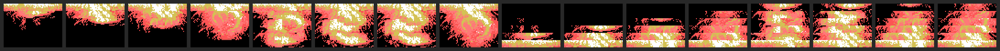
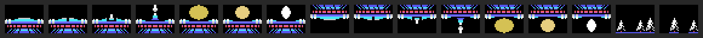

## Los jefes

Son cinco (`0xE340`), cada uno con su ficha de 10 bytes (`p09:BB01`), su caja
y su núcleo. El 1 dispara seis balas en abanico. El 2 embiste y suelta
enemigos de cuatro sprites. El 3 lanza lenguas que crecen. El 4 suelta rayos.
El 5 son diez piezas que salen de dos en dos.

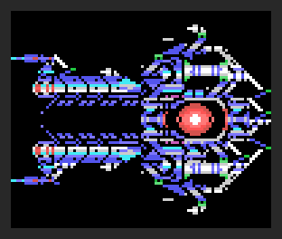
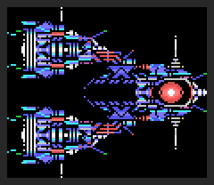
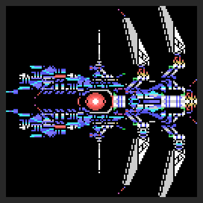
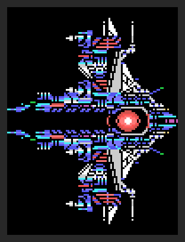
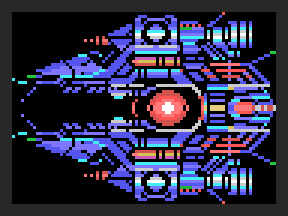

Al vencer a uno, su boca queda abierta 300 cuadros (`p11:A93F`). Si la nave
entra, va al interior; si no, el jefe estalla y no hay interior.

## El interior

Tiene un núcleo de 24 golpes (`p02:8570`). Al pasar la nave por su X empieza
el final de 13 pasos (`p01:74A2`), con YOU CAPTURED. El premio depende de los
cuadros que duró la pelea con el jefe (`p02:9218`): con menos de 300, dos
armas; con menos de 900, una; si no, NOTHING.

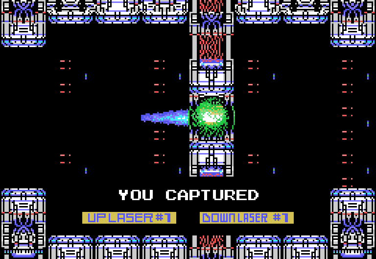
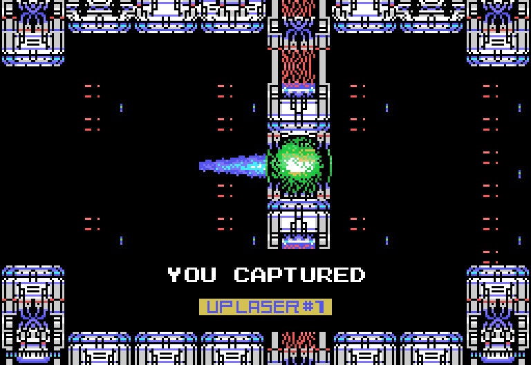
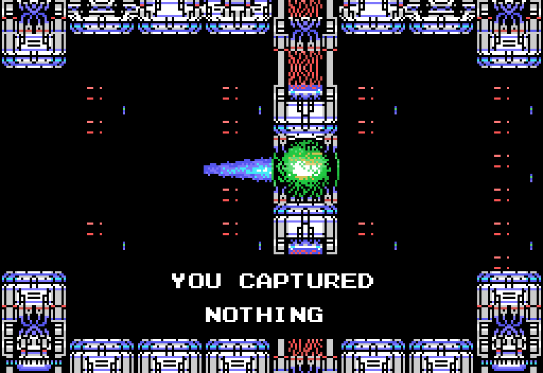

## La nave y el medidor

Las cápsulas rojas mueven la casilla encendida del medidor, y el otro botón
la usa (`p01:7D4F`). El medidor tiene más o menos casillas según las armas
capturadas (`p02:8060`). Las siete que se capturan, en orden, son UP LASER,
DOWN LASER, NAPALM MISSILE, REFLEX RING, EXTEND LASER, BACK BEAM y FIRE
BLASTER. El escudo aguanta 10 golpes, y la cápsula azul hace caer a todos los
enemigos de la pantalla.

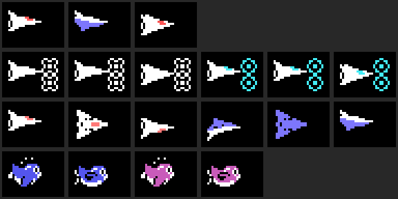

Los 25 rótulos del medidor (`p14:9BD3`):

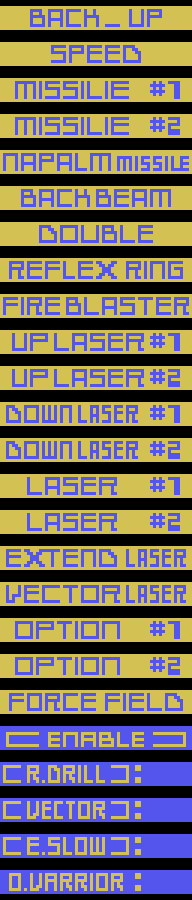

Las cápsulas especiales salen en el mapa y duran 15 segundos
(`p02:9034`). Con D.VARRIOR las opciones giran alrededor de la nave; R.DRILL
convierte la nave en una broca que rompe paredes; E.SLOW hace que los
enemigos se muevan cuadro sí, cuadro no; VECTOR cambia el disparo.

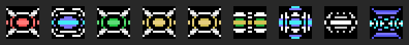

De izquierda a derecha: la del medidor (0x29), la que hace caer a todos
(0x2A), la vida (0x2B), las dos de puntos (0x2C y 0x2D), y D.VARRIOR,
R.DRILL, E.SLOW y VECTOR.
